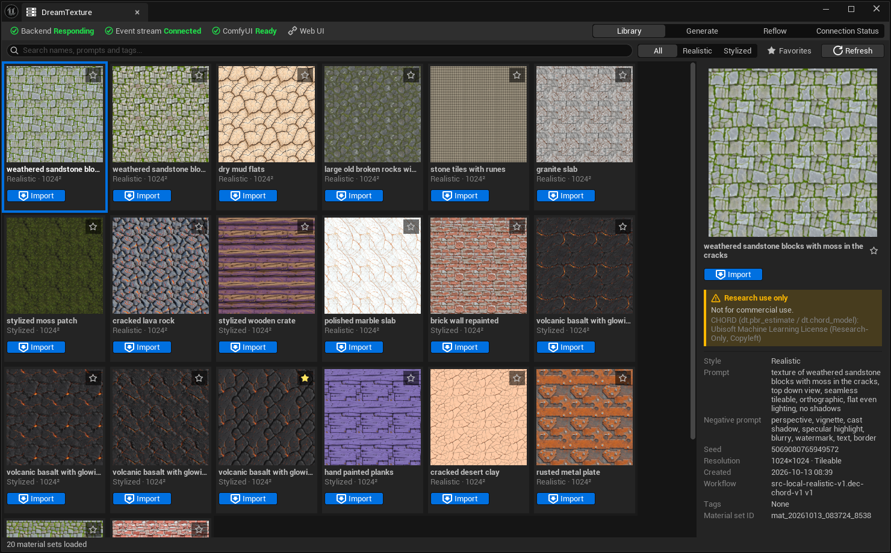
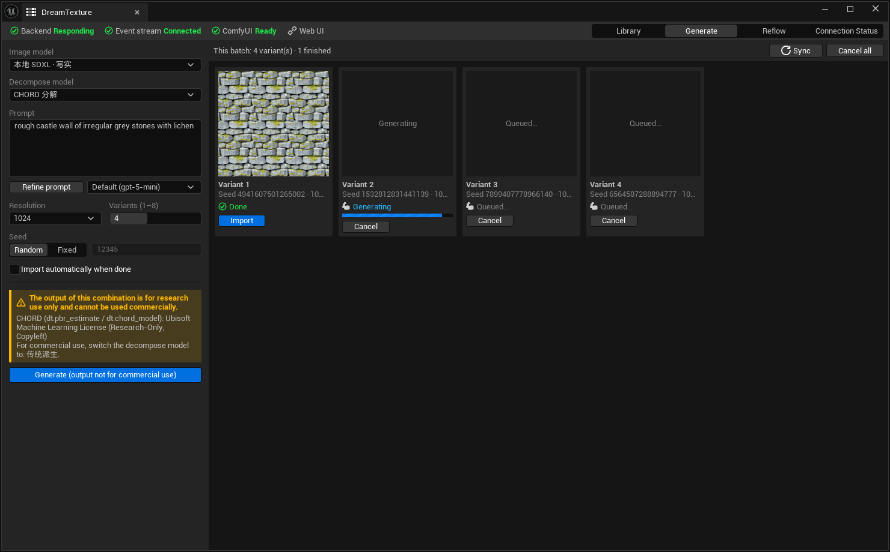
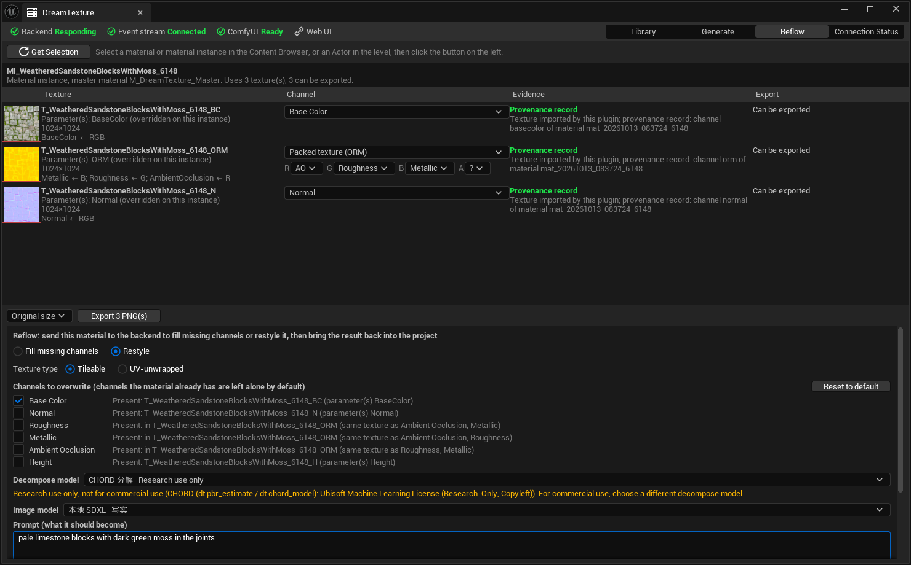
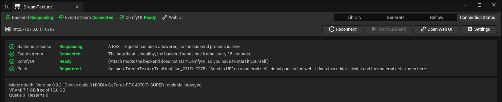

# DreamTexture for Unreal

**用 DreamTexture 生成 PBR 材质套装，不离开虚幻编辑器就能用上。**

<p>
  
  
  
</p>

[English](README.md) · [文档](Docs/index.md) · [快速上手](Docs/getting-started.md) · [更新记录](CHANGELOG.md) · [Issues](https://github.com/TypeDreamMoon/DreamTextureForUnreal/issues)

DreamTexture for Unreal 是一个仅编辑器的插件，把虚幻编辑器接到正在运行的
[DreamTexture 后端](https://github.com/TypeDreamMoon/DreamTexture)。后端在本机 ComfyUI 上把一句提示词变成一整套
PBR 材质（BaseColor、Normal、Roughness、Metallic、AO、Height，以及打包的 ORM）。

在同一个面板里，你可以浏览后端的素材库、把一套材质导入成配置正确的贴图加一个材质实例、赋给选中的物体、
生成新的材质，也可以把工程里已有的材质送回后端补齐缺失的通道或改写外观。Web 端点一下「发送到 UE」，
材质就出现在正开着的编辑器里。

> [!NOTE]
> 这是 **Beta** 版本。插件本身不生成任何东西，需要 DreamTexture 后端和 ComfyUI。部分功能要求较新的后端，
> 见 [后端](Docs/backend.md#which-backend-version)（英文）。

<p align="center">
  
</p>

## 功能一览

| | |
| :-- | :-- |
| **素材库** | 在编辑器里浏览后端的素材库：搜索、按风格筛选、收藏。一键导入一套材质。详情里有提示词、种子、分辨率和**许可**。[素材库](Docs/features/library.md) |
| **导入** | 一套材质落成 `/Game/DreamTexture/<名字>_<id>/` 下的贴图，每个通道的压缩与 sRGB 都配好。同一套再导一次什么都不下载；变了的通道就地更新，已经连好的材质不会断。 |
| **材质实例与赋值** | 每次导入同时建 `MI_<名字>`，父材质是插件在你工程里生成的母材质。「赋给选中物体」把它放到选中的 Actor 或静态网格上，整个操作是一个可撤销的事务。 |
| **生成** | 写提示词，选出图模型和分解模型，一次出 1 到 8 个变体。进度和 Web 端走同一条事件流。可选云端底图与提示词扩写。[生成](Docs/features/generate.md) |
| **回流：补齐缺失通道** | 选工程里任意材质，插件认出每张贴图是哪个通道，只把底色送给后端，补回缺的法线、粗糙度、AO、高度。你原来的底色保持不变。[回流](Docs/features/reflow.md) |
| **回流：改写外观** | 用原来的底色当参考图，按提示词重画，再整套分解。 |
| **平铺与 UV 展开** | 回流把无缝平铺的材质和 UV 展开的贴图（角色、道具、trim sheet）分开处理：UV 展开的不做无缝处理，重绘幅度有硬上限。 |
| **Web 端推送** | Web 端素材页上的「发送到 UE」把材质导入正开着的编辑器。编辑器正好在重连时推送也不会丢。[推送](Docs/features/push.md) |
| **后端进程托管** | 插件可以替你启动和停止后端。端口上已有后端就直接附着，不是它启动的后端绝不会去停。[后端](Docs/backend.md) |

<p align="center">
  
</p>

<p align="center">
  
</p>

<p align="center">
  
</p>

## 要求

| | |
| :-- | :-- |
| 虚幻引擎 | **5.8**。仅编辑器，不会进入打包后的游戏。 |
| 系统 | Windows（Win64）。其它平台没有构建或测试过。 |
| 后端 | [DreamTexture 后端](https://github.com/TypeDreamMoon/DreamTexture)，以及它能驱动的 ComfyUI（后端可以自己部署一份）。推送、回流、CHORD 的环绕填充开关需要较新的后端，见 [后端](Docs/backend.md#which-backend-version)。 |
| 显卡 | NVIDIA。开发与测试用的是 16 GB 显存。本地 SDXL 出图要空闲 8 GB 左右，CHORD 3 到 5 GB；云端底图要的少得多。 |
| 工具链 | 能为 UE 5.8 编译 C++ 的环境（装了 C++ 工作负载的 Visual Studio）。插件只发源码。 |

编辑器和 ComfyUI 抢显存。开着大关卡、本地模型又载进来时，生成可能慢到几十倍而且不报任何错。
见 [故障排查](Docs/troubleshooting.md#generation-never-finishes-or-is-very-slow)。

## 安装

**用 git：**

```powershell
cd <你的工程>/Plugins
git clone https://github.com/TypeDreamMoon/DreamTextureForUnreal.git
```

**用发布包：** 从 [Releases](https://github.com/TypeDreamMoon/DreamTextureForUnreal/releases) 下载
`DreamTextureForUnreal-<版本>.zip`，把里面的 `DreamTextureForUnreal` 文件夹解压到 `<你的工程>/Plugins/`。

然后打开工程，在 *编辑 ▸ 插件* 里确认 **DreamTexture for Unreal** 已启用，编辑器问要不要编译时选是。
面板在 *工具 ▸ DreamTexture*。

## 快速开始

1. **起后端。** 运行 `dreamtexture.exe`，浏览器打开 <http://127.0.0.1:8777> 确认它在。安装见
   [后端](Docs/backend.md)。也可以在 *项目设置 ▸ 插件 ▸ DreamTexture* 里填好后端可执行文件，让插件替你启动。
2. **打开面板**：*工具 ▸ DreamTexture*。顶部的状态条分开显示三件事：后端进程、长连接、ComfyUI。
   只浏览素材库的话，只要第一项是绿的。
3. **导入一套。** 在「素材库」页选一套材质，点「导入」。完成后会弹通知，写明建了什么，并可以跳到内容浏览器。
4. **赋给物体。** 在关卡里选一个带网格的 Actor，或在内容浏览器里选一个静态网格，点「赋给选中物体」。
   对话框会先告诉你将替换几个材质槽，之后才改。Ctrl+Z 一次全部撤销。

**生成新的一套。** 在「生成」页选出图模型和分解模型，写提示词（「扩写」会把它扩成适合平铺贴图的提示词），
选分辨率和变体数，点「生成」。变体完成后点「导入」，或者打开「完成后自动导入」。

**回流已有的材质。** 选中一个材质实例（或选中 Actor 上的一个材质槽），打开「回流」页，点「取当前选择」。
确认插件认出的通道，选「补齐缺失通道」或「改写外观」，选「平铺」或「UV 展开」，点「开始」。
默认结果落成新的一套贴图和新的实例；选「原地覆盖」则直接改选中的那个实例。

## 许可：CHORD 仅限研究用途

写实管线可以用 [CHORD](https://github.com/ubisoft/ComfyUI-Chord) 分解。它是 Ubisoft 以**仅限研究用途**
（research-only）许可发布的。**用 CHORD 分解出来的材质不可商用。**

插件在能标的地方都标了：素材库和生成变体上的「仅限研究用途」标记、提交这类组合之前「生成」按钮上的警告、
导入通知里的授权一行。要出货的话，分解模型换成「传统派生」。每套材质的 manifest 里的 `license_flags` 字段
是同一份信息。

标记只是方便，不是法律审查。用到的模型，请自己读它们的许可。

## 文档

文档以英文为主。

| | |
| :-- | :-- |
| [快速上手](Docs/getting-started.md) | 安装、连接、第一次导入 |
| [后端](Docs/backend.md) | 安装 DreamTexture 后端、配置、attach 与 managed 模式、显存 |
| [素材库](Docs/features/library.md) | 浏览、导入、赋值 |
| [生成](Docs/features/generate.md) | 在编辑器里生成 |
| [回流](Docs/features/reflow.md) | 补齐缺失通道、改写外观、平铺与 UV 展开 |
| [Web 端推送](Docs/features/push.md) | 发送到 UE |
| [故障排查](Docs/troubleshooting.md) | 怎么读三级状态、常见故障 |
| [参与开发](Docs/contributing.md) | 测试宿主、跑测试、本地化、发布 |
| [更新记录](CHANGELOG.md) | 英文 |

## 开发与测试

仓库根目录就是插件根，插件自己编不了。开发在一个只装这个插件的小型宿主工程里做，插件以 git worktree 挂在里面。
自动化测试无头运行，对着一个固定数据的测试后端：

```powershell
pwsh -NoProfile -File Tools\Test.ps1            # 构建并跑全部 DreamTexture.* 测试
pwsh -NoProfile -File Tools\Test.ps1 -Live      # 另外跑要连后端的测试
```

细节见 [参与开发](Docs/contributing.md)，其中有发布前必须合跑一次的那条命令。

## 项目信息

| | |
| :-- | :-- |
| 版本 | `0.9.0`（beta） |
| 虚幻引擎 | `5.8` |
| 模块 | `DreamTextureClient`、`DreamTextureAssets`、`DreamTextureEditor`（均为 Editor） |
| 作者 | TypeDreamMoon |
| 后端 | <https://github.com/TypeDreamMoon/DreamTexture> |
| 许可 | [MIT](LICENSE) |

## 许可

DreamTexture for Unreal 以 [MIT 许可](LICENSE) 发布，只涵盖这个插件本身。后端和它跑的模型各有各的许可，
见上面关于 CHORD 的说明。报 bug、提需求请开 [issue](https://github.com/TypeDreamMoon/DreamTextureForUnreal/issues/new)。
